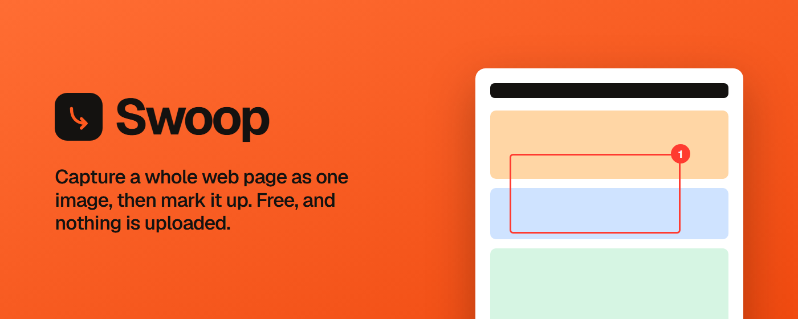
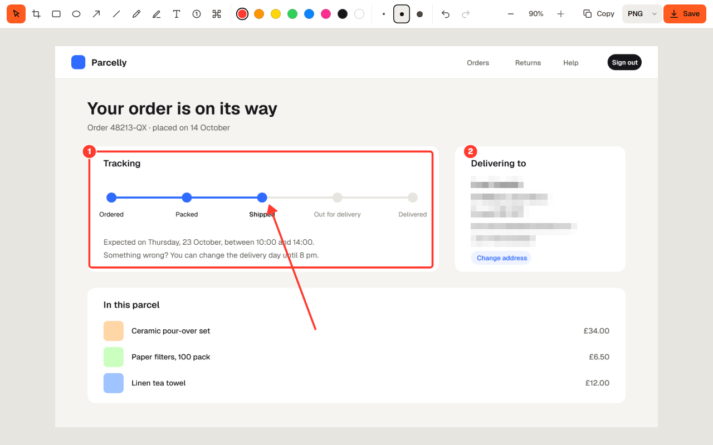

<p align="center">
  
</p>

# Swoop

Screenshots that stay on your computer. A full-page capture extension for Chrome, and a tiny Print Screen app for Windows and Linux, sharing one free editor.

**[Open the Swoop page](https://mhfrough.github.io/swoop/)** · **[Downloads](https://github.com/mhfrough/swoop/releases/latest)** · **[Privacy policy](https://mhfrough.github.io/swoop/privacy.html)**

- **Swoop for Chrome** captures a whole web page, top to bottom, as one image.
- **Swoop for Windows and Linux** waits in the tray. Press Print Screen, drag over any part of the screen, mark it up, then copy or save.
- **One editor, every tool free:** arrow, box, ellipse, line, pen, highlighter, text, numbered steps, blur and crop, with undo and redo. No paid tier and no watermark.
- **Nothing is uploaded.** There is no Swoop server, account, cloud gallery or share link. Pictures go to your clipboard or your disk.

<p align="center">
  
</p>

## Download

| | File | For |
|---|---|---|
| Chrome and Edge | [`swoop-chrome.zip`](https://github.com/mhfrough/swoop/releases/latest/download/swoop-chrome.zip) | Load it unpacked until the Chrome Web Store listing is live (below) |
| Windows | [`Swoop-setup.exe`](https://github.com/mhfrough/swoop/releases/latest/download/Swoop-setup.exe) | Windows 10 and 11, 64-bit. Installs for you only, no admin rights |
| Linux | Coming soon | `.deb` for Debian and Ubuntu, `.rpm` for Fedora, and an AppImage |
| Mac | Coming soon | Until then, Swoop for Chrome works on a Mac |

Every release also has the same files with the version in the name. See [all releases](https://github.com/mhfrough/swoop/releases).

**Load the extension unpacked:** unzip `swoop-chrome.zip`, open `chrome://extensions`, turn on **Developer mode**, choose **Load unpacked** and pick the unzipped folder.

**Windows says the publisher is unknown:** the installer is not code-signed yet, so SmartScreen may warn the first time. Choose **More info**, then **Run anyway**.

## Swoop for Chrome

Click the Swoop button or press <kbd>Alt</kbd>+<kbd>Shift</kbd>+<kbd>S</kbd>. Swoop scrolls the page one screen at a time, joins the parts into one tall image and opens it in the editor. <kbd>Alt</kbd>+<kbd>Shift</kbd>+<kbd>V</kbd> takes only the part you can see. Both are also on the Swoop button's right-click menu.

It is built for real pages, not just simple ones:

- **Sticky headers and cookie bars show once,** not on every screen. Fixed headers appear at the top of the picture and fixed bottom bars at the bottom.
- **Nothing is left blank.** Swoop scrolls through the page once before capturing, so lazy images, infinite lists and fade-in effects have loaded.
- **Web apps work too.** When the page scrolls inside a box instead of the window, Swoop finds the largest scrolling box and captures that.
- **No scrollbars or smooth-scroll jumps** in the picture. The page is put back exactly as it was afterwards.
- **Very tall pages** are scaled down to fit Chrome's limit of 32,767 pixels, and the editor says so.
- **Save as PNG, JPG, WebP or PDF,** or copy to the clipboard. A long page becomes several A4 pages in the PDF. Your last 12 captures are kept in the browser.
- **Right-click the picture** for Copy, Save, Save as PDF, Undo and Delete, right where the pointer is.
- **Click the title to rename the capture.** The name is also the file name.

Settings (right-click the Swoop button, then **Options**): scroll the page first, show fixed headers once, and how long to wait on each screen for slow animations.

**Permissions:** only `activeTab`, `scripting`, `contextMenus`, `storage` and `unlimitedStorage`. Swoop can see a tab only after you click its button, so the install screen shows no "read all your data" warning.

## Swoop for Windows and Linux

Swoop starts with your computer and sits in the tray.

1. Press <kbd>Print Screen</kbd>, or click the tray icon. The screen under the pointer freezes, so menus and tooltips stay put.
2. Drag over the part you want. The size shows as you drag, and the toolbar appears next to the selection.
3. Mark it up, then press <kbd>Enter</kbd> to copy and close, <kbd>Ctrl</kbd>+<kbd>S</kbd> to save, or <kbd>Ctrl</kbd>+<kbd>Shift</kbd>+<kbd>S</kbd> to choose where. <kbd>Esc</kbd> cancels.

Screenshots are saved full size to `Pictures/Swoop`, named with the date and time, for example `Swoop 2026-10-22 at 14.03.22.png`. The tray menu has the screenshots folder, the start-with-computer switch and the settings window.

**Print Screen is your choice.** The settings window and the tray menu have a **Print Screen opens Swoop** switch, on by default. On, Swoop takes the key, even when the Snipping Tool or another screenshot app (Lightshot, ShareX, Greenshot) has it: it turns off Windows' *Use the Print screen key to open screen capture* setting and, if another app holds the key, uses a keyboard hook that sees it first. Off, Swoop lets go of the key and puts Windows' setting back as it was. Combinations with <kbd>Alt</kbd>, <kbd>Ctrl</kbd>, <kbd>Shift</kbd> or <kbd>Win</kbd> are always left alone.

**Updating** is just running the new `Swoop-setup.exe`: it closes Swoop, installs over the old version and keeps your settings.

**Wayland.** Apps cannot listen for keys on Wayland. Add a keyboard shortcut in your system settings that runs `swoop --capture`. The app menu entry also has a **Capture an area** action. On X11, Print Screen works out of the box.

**Small and light.** Swoop is built with [Tauri 2](https://tauri.app/) and the system's own web view (WebView2 on Windows, WebKitGTK on Linux): a 1.4 MB installer and about 30 MB of memory while it waits. Only one copy runs at a time; running `swoop --capture` again starts a capture in the copy that is running.

## Editor keys

| Key | Tool | Key | Action |
|---|---|---|---|
| <kbd>V</kbd> | Select and move | <kbd>Ctrl</kbd>+<kbd>Z</kbd> | Undo |
| <kbd>C</kbd> | Crop (Chrome) | <kbd>Ctrl</kbd>+<kbd>Shift</kbd>+<kbd>Z</kbd> | Redo |
| <kbd>R</kbd> | Rectangle | <kbd>Delete</kbd> | Delete the selected mark |
| <kbd>O</kbd> | Ellipse | <kbd>Ctrl</kbd>+<kbd>C</kbd> | Copy |
| <kbd>A</kbd> | Arrow | <kbd>Ctrl</kbd>+<kbd>S</kbd> | Save |
| <kbd>L</kbd> | Line | <kbd>Ctrl</kbd>+<kbd>0</kbd> | Fit to the window (Chrome) |
| <kbd>P</kbd> | Pen | <kbd>Space</kbd> + drag | Pan (Chrome) |
| <kbd>H</kbd> | Highlighter | <kbd>Enter</kbd> | Copy and close (desktop) |
| <kbd>T</kbd> | Text | <kbd>Esc</kbd> | Cancel or close |
| <kbd>N</kbd> | Numbered step | | |
| <kbd>B</kbd> | Blur | | |

## Privacy

- The extension and the app have no server to send anything to, and make no network requests.
- The extension keeps captures in its own storage in your browser. Removing the extension deletes them.
- The desktop app holds the frozen screen in memory only until you close the capture.
- The landing page has no analytics or cookies. Its one request to another site is the star count on the GitHub button, from GitHub's public API at most once every five minutes.

The full policy is at [mhfrough.github.io/swoop/privacy.html](https://mhfrough.github.io/swoop/privacy.html).

## Build it yourself

You need [Node.js](https://nodejs.org/) 22 and Python 3. For the desktop app, also [Rust](https://rustup.rs/) and, on Linux, the libraries in the **Linux libraries** step of [`.github/workflows/release.yml`](.github/workflows/release.yml).

```bash
npm install
npx playwright install chromium
```

| Command | What it does |
|---|---|
| `npm run serve` | Serves the landing page at http://localhost:8175 |
| `npm test` | Checks the editor copies, then runs the Playwright tests |
| `npm run sync` | Copies `shared/editor` into `extension/` and `desktop/ui/` (run after editing the editor) |
| `npm run zip:extension` | Packs `extension/` into `dist/swoop-chrome-<version>.zip` |
| `npm run icons` | Renders `icon.svg` to every icon size |
| `node tools/make-brand.mjs` | Draws the installer and Chrome Web Store artwork |
| `cd desktop && npm install && npm run build` | Builds the desktop app and its installer for this system |
| `cd desktop && npm run dev` | Runs the desktop app with live reload |

The extension needs no build step: load the `extension/` folder unpacked.

The tests cover the full-page capture end to end in real Chromium (sticky header, fixed bar, scroll animations, lazy images, a page that scrolls inside a box), the desktop overlay and settings window with a stand-in for the Rust side, and the landing and privacy pages in light, dark and phone sizes.

## How it is built

| Part | Files |
|---|---|
| The editor, shared by everything | `shared/editor/editor.js`, `editor.css`: plain JavaScript, no dependencies |
| Chrome extension (Manifest V3) | `extension/`: `background.js` runs the capture, `capture.js` prepares the page, `editor.html` opens the result |
| Desktop app | `desktop/src-tauri/src/lib.rs` (tray, Print Screen, capture with `xcap`, clipboard with `arboard`), `desktop/ui/` (overlay and settings window) |
| Landing page | `index.html`, `site.css`, `site.js`, `tokens.css`, `privacy.html` |
| Tests | `tests/`, with Playwright |
| Releases | `.github/workflows/release.yml` builds every download on a `v*` tag; `test.yml` runs the tests on every push |
| Installer and store artwork | `desktop/src-tauri/installer/`, `store/` (listing text in `store/listing.md`) |

How the full-page capture works, why the desktop app uses Tauri, and what is planned next are in [PLAN.md](PLAN.md).

## Release a new version

1. Update the version in `extension/manifest.json`, `desktop/src-tauri/tauri.conf.json`, `desktop/src-tauri/Cargo.toml`, `desktop/package.json`, and in `index.html` (the download section and the `softwareVersion` fields of the structured data). A test checks that they match.
2. Commit, then push a tag: `git tag v0.2.0 && git push origin v0.2.0`.
3. GitHub Actions builds the Windows installer, the Linux packages and the extension zip, and attaches them to a new release.

## Not yet

- A Mac app (Tauri supports it; it needs signing and the Screen Recording permission).
- Selecting across several monitors (the desktop app captures the monitor under the pointer), a timer and window capture.
- Capturing one element or a selected area in the extension, and pages that scroll sideways.
- Firefox and the Edge Add-ons store (Edge already loads the Chrome extension as it is).

## Credits

- [Geist and Geist Mono](https://vercel.com/font) by Vercel, SIL Open Font License 1.1 (`assets/fonts/Geist-OFL.txt`).
- [Tauri](https://tauri.app/), [xcap](https://github.com/nashaofu/xcap) and [arboard](https://github.com/1Password/arboard) for the desktop app.

## Licence

MIT. See [LICENSE](LICENSE).

Made by Mohammad Hamza ([@mhfrough](https://github.com/mhfrough)).
